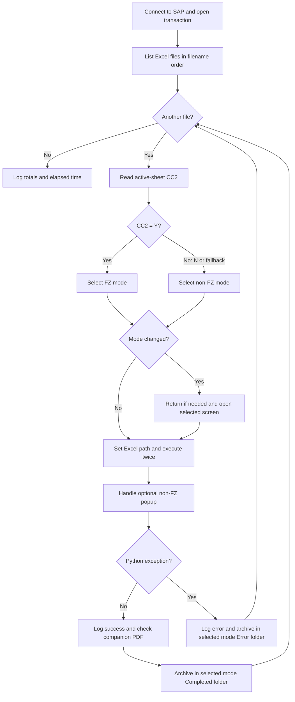

# SAP Import Declaration Upload

Automate the upload of import customs declaration Excel files into SAP using SAP GUI Scripting, with separate workflows for Free Zone (FZ) and non-FZ imports, file archiving, and processing logs.

## Purpose

This project automates repetitive SAP GUI actions used to upload import customs declaration data. It distinguishes between imports under Thailand's Free Zone (FZ) scheme and non-FZ imports using a marker in the input workbook.

The notebook operates on existing Excel upload files. It does not extract data from PDFs, calculate customs benefits, or determine legal eligibility.

## Workflow

1. Open SAP Logon, connect to the configured system, log in, and enter the configured transaction.
2. Scan the input folder for `.xlsx` files and process them in filename order.
3. Read cell `CC2` on the workbook's active worksheet to select the upload mode.
4. Switch between the transaction's FZ and non-FZ screens as needed.
5. Submit the Excel file through the SAP GUI.
6. Move the Excel file and any PDF with the same base filename into the selected mode's `Completed` or `Error` folder.
7. Record timestamps, processing messages, counts, missing PDFs, and elapsed time.

## FZ / non-FZ classification

| Value in active-sheet cell CC2 | Mode |
| --- | --- |
| `Y` after trimming whitespace and converting to uppercase | FZ |
| `N` | non-FZ |
| Blank or any other value | non-FZ fallback in the current implementation |
| Workbook cannot be read | Logged as a read error; current implementation falls back to non-FZ |

This is a rule for the source file format, rather than a general customs classification rule.

## Python processing flow

Column `CC` contains the Free Zone indicator: `Y` means FZ and `N` means non-FZ. The script reads **CC2 on the active worksheet** once per workbook; it does not inspect every row in column CC.



`wait_for_sap()` waits while SAP is busy and raises an exception after 30 seconds. `switch_mode()` reuses the current screen for consecutive files of the same type. `move_files()` archives the Excel and matching PDF when present.

Workbook read failures are caught inside `check_cc2_column()` and return the non-FZ fallback. The error branch shown above handles exceptions propagated during mode switching, upload, or archiving; an archiving failure can interrupt that branch too. The absence of a Python exception does not confirm successful posting in SAP.

## Input files

Place the Excel upload files in one input folder. A companion PDF is optional and must have the same base filename, for example:

- `declaration_001.xlsx`
- `declaration_001.pdf`

Only the Excel file is supplied to the SAP upload screen. The PDF is archived alongside it; a missing PDF generates a warning without preventing the upload.

## Requirements

- Windows with SAP GUI installed.
- SAP GUI Scripting enabled in the relevant client and SAP system.
- An account with access to the required transaction.
- Python, Jupyter, `pywin32`, and `openpyxl`.
- Excel files matching the format expected by the SAP transaction.

Install dependencies:

```powershell
python -m pip install -r requirements.txt
python -m pip install jupyter
```

## Configuration and execution

The published notebook reads configuration and credentials from environment variables. It contains no embedded login credentials or personal folder paths.

Set these variables in PowerShell, using your own values. Start Jupyter from the same PowerShell session so the kernel inherits them.

```powershell
$env:SAP_CONNECTION_NAME = "YOUR_SAP_CONNECTION"
$env:SAP_USERNAME = Read-Host "SAP username"
$securePassword = Read-Host "SAP password" -AsSecureString
$env:SAP_PASSWORD = [System.Net.NetworkCredential]::new("", $securePassword).Password
$env:SAP_TRANSACTION_CODE = "YOUR_TRANSACTION"
$env:SAP_UPLOAD_PATH = "C:\SAPUpload\Input"
$env:SAP_LOG_ARCHIVE_PATH = "C:\SAPUpload\Logs"
$env:SAP_NON_FZ_ARCHIVE_PATH = "C:\SAPUpload\Archive\Non-FZ"
$env:SAP_FZ_ARCHIVE_PATH = "C:\SAPUpload\Archive\FZ"
python -m jupyter notebook
```

Optional: set `SAP_PATH` if SAP Logon is installed somewhere other than the default path in the notebook.

Open `sap_import_declaration_upload.ipynb` and run the cells in order. The final cell starts SAP processing and moves input files. Use copies of input files and validate the workflow in a test SAP environment first.

The original transaction-specific screen IDs remain in the notebook. Changing the transaction code alone is insufficient to adapt it to another SAP implementation; update and validate the screen IDs and action sequence as well.

## Current limitations

- **The companion PDF and Excel file must have exactly the same base filename**, for example `declaration_001.xlsx` and `declaration_001.pdf`. The script searches for the Excel base filename followed by `.pdf` in the input folder; a differently named PDF will not be found or archived alongside the Excel file. A missing matching PDF generates a warning but does not block the Excel upload.

- **Success is based on the absence of a Python exception.** The script does not inspect SAP status messages or verify that a document was posted. A `Completed` file therefore requires independent SAP verification.
- An unreadable workbook currently defaults to non-FZ after logging the read failure.
- Missing PDFs do not block processing.
- Fixed startup delays and screen IDs depend on the local SAP setup.
- The non-FZ popup handler suppresses exceptions, including failures other than an absent popup.
- Duplicate destination filenames, file-move failures, and recovery after SAP screen errors need further handling.
- The success counter increments before archiving, so an archive failure can also increment the error counter for that file.

## Repository contents

| File | Purpose |
| --- | --- |
| `sap_import_declaration_upload.ipynb` | Workflow with Y/N classification, environment-based configuration, and cleared outputs |
| `requirements.txt` | Runtime dependencies |
| `.gitignore` | Excludes local configuration, declaration files, logs, and notebook checkpoints |

## Validation

The published notebook's Python cells were checked for syntax. Live SAP execution has not been tested in this environment.
